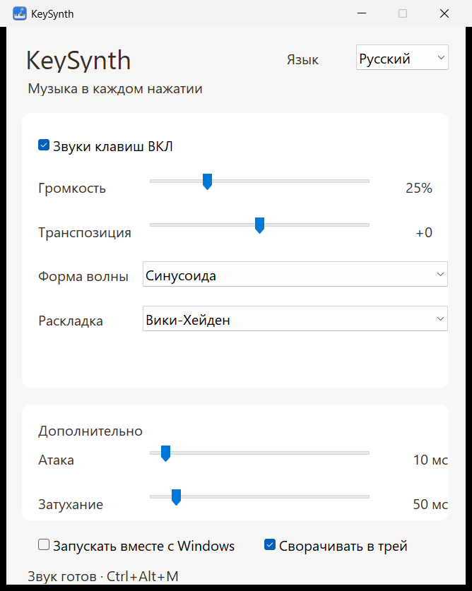

# KeySynth

Маленький автономный синтезатор для Windows 10/11 x64. Запустите `KeySynth.exe` и начните печатать в обычном приложении: физические нажатия клавиш создают ноты, удержание поддерживает звук, отпускание плавно его гасит. Можно использовать переносимый EXE или установщик; права администратора не нужны.

Исходники: [SillWo/KeySynth](https://github.com/SillWo/KeySynth). Текущая версия — **0.2.0**.

## Интерфейс и запуск

Нативное окно использует Segoe UI, светлые панели и стандартные элементы Windows. Переключатель языка вверху окна меняет интерфейс и меню трея между **Русским** и **English** без перезапуска; выбор сохраняется. По умолчанию выбран русский язык.



| Настройка | Диапазон / варианты | При первом запуске |
| --- | --- | --- |
| Звуки клавиш | Включено / выключено | Включено |
| Громкость | 0–100% | 25% |
| Транспозиция | −24…+24 полутона | 0 |
| Форма волны | Sine, Triangle, Sawtooth, Square | Sine |
| Раскладка | Wicki-Hayden, Chromatic, Random | Wicki-Hayden |
| Атака | 0–200 мс | 10 мс |
| Затухание | 0–500 мс | 50 мс |
| Запускать вместе с Windows | Автозапуск текущего EXE | Выключено |
| Сворачивать в трей | Сворачивать и закрывать окно в tray | Включено |

`Ctrl+Alt+M` глобально переключает звуки. Если сочетание занято, используйте окно или меню tray. Двойной щелчок по значку tray открывает окно; меню содержит **Открыть**, **Включить / Выключить звуки**, **Выход**. Для полного завершения выберите **Выход**. Если отключить **Сворачивать в трей**, закрытие окна завершит приложение.

Для автозапуска используется только запись `KeySynth` в `HKCU\Software\Microsoft\Windows\CurrentVersion\Run`, с кавычками вокруг пути и аргументом `--tray`. Сначала положите EXE в постоянную папку, затем включите автозапуск. После перемещения EXE выключите и снова включите эту настройку.

## Установка и удаление

Запустите `KeySynth-0.2.0-Setup.exe`, выберите язык мастера и завершите установку. Приложение устанавливается для текущего пользователя в `%LOCALAPPDATA%\Programs\KeySynth`; ярлык появляется в меню «Пуск», ярлык на рабочем столе можно включить отдельно. Автозапуск включается в самом приложении.

Удаление доступно через «Параметры Windows → Приложения → Установленные приложения → KeySynth». Настройки интерфейса и звука сохраняются для повторной установки; запись автозапуска установленной копии удаляется. Переносимый `KeySynth.exe` также работает самостоятельно.

## Как получается звук

Rust и crate `windows` предоставляют доступ к Win32. `WH_KEYBOARD_LL` передаёт компактные события через ограниченную SPSC-очередь одному аудиопотоку. Callback hook не пишет файлы, не ждёт mutex и всегда пропускает ввод дальше. Повтор удерживаемой клавиши не создаёт дополнительные голоса.

Аудиобэкенд — **прямой WASAPI в shared event-driven режиме**. Предпочтительно используется `IAudioClient3` с периодом около 5 мс, допустимым для устройства; предусмотрен обычный shared WASAPI fallback. Сторонней аудиобиблиотеки нет. Когда голоса и release закончатся, поток останавливает вывод и ждёт события. Каждый голос хранит фазу и огибающую; память голосов и очередь заранее ограничены. Sawtooth и Square используют PolyBLEP. WAV/MP3 и другие аудиофайлы не нужны.

Перед готовностью нового устройства выполняется один беззвучный Start/Stop/Reset. Это переносит холодную инициализацию драйвера в запуск приложения; после прогрева поток снова остановлен, фонового непрерывного воспроизведения нет.

Техническое основание выбора периода: [Microsoft: IAudioClient3::InitializeSharedAudioStream](https://learn.microsoft.com/en-us/windows/win32/api/audioclient/nf-audioclient-iaudioclient3-initializesharedaudiostream). Реальная задержка зависит от аудиодрайвера, устройства, загрузки Windows и Attack; период потока не является измерением полной задержки от клавиши до динамика.

## Физические клавиши и музыкальные режимы

Scan code и extended flag идентифицируют клавишу независимо от RU/EN, Shift, Caps Lock и текста. Основная сетка декларативно описана в `src/mapping.rs`: ZXCV, ASDF, QWERTY и верхний ряд от grave до equals. Для четырёх рядов используются верхние четыре смещения заданной пятистрочной сетки:

- Wicki-Hayden: `72 + [-19, -14, -9, -4][row] + column × 2 + transpose`.
- Chromatic: `72 + [-12, -7, -1, 4][row] + column + transpose`.
- Random: стабильная для физической клавиши в текущем запуске нота в пределах `72 ± 12`, затем transpose.

Специальные клавиши и numpad получают стабильные fallback-ноты. Режим, форма волны и transpose применяются к новым нотам; громкость изменяется плавно. Максимум — 128 независимых голосов, включая затухающие; при исчерпании лимита переиспользуется старый голос.

## Настройки и приватность

Настройки хранятся в пользовательском ключе `HKCU\Software\KeySynth`. Отсутствующие или некорректные значения заменяются настройками по умолчанию. Базы данных нет. В реестре находятся только настройки приложения и, при включении, запись автозапуска.

**KeySynth не сохраняет историю или последовательности нажатий и не передаёт события клавиатуры.** Событие нужно только для управления музыкальным голосом. В программе нет telemetry, analytics, crash reporting, проверки обновлений и сетевых запросов. Работа полностью offline. Состояние удерживаемых клавиш и короткая очередь событий существуют только в оперативной памяти и освобождаются при завершении.

## Сборка

Нужны Rust stable и инструменты сборки Windows x64. Обычный вариант — MSVC с Visual Studio Build Tools (Desktop development with C++) и Windows SDK. Выполняйте команды в **x64 Native Tools Command Prompt / Developer PowerShell**, где доступны linker и `rc.exe`: ресурсный компилятор встраивает значок, версию и manifest без дополнительных Rust-зависимостей.

```powershell
cargo fmt --check
cargo clippy --all-targets --all-features
cargo test
cargo build --release
```

Результат стандартной сборки: `target\release\keysynth.exe`. Его можно переименовать в `KeySynth.exe` и перенести в удобную папку. Release: `opt-level=3`, LTO, один codegen unit, `panic=abort`, удаление символов.

Переносимая альтернатива без Visual Studio — Rust `stable-x86_64-pc-windows-gnullvm` и [LLVM-MinGW](https://github.com/mstorsjo/llvm-mingw). Добавьте папку `bin` LLVM-MinGW в PATH, выберите этот toolchain и при необходимости задайте `CARGO_TARGET_X86_64_PC_WINDOWS_GNULLVM_LINKER` полным путём к `x86_64-w64-mingw32-clang.exe`. `.cargo/config.toml` включает статическую CRT для этого target, чтобы EXE не требовал `libunwind.dll`. Укажите target явно, чтобы настройки статической CRT не применялись к host-макросам:

```powershell
cargo +stable-x86_64-pc-windows-gnullvm build --release --target x86_64-pc-windows-gnullvm
```

Результат: `target\x86_64-pc-windows-gnullvm\release\keysynth.exe`. Инструменты сборки нужны только разработчику, не пользователю EXE.

Для этой альтернативы в PATH также нужен `llvm-windres` из LLVM-MinGW; путь можно задать переменной `LLVM_WINDRES`.

### Сборка установщика

Установите [Inno Setup 7](https://jrsoftware.org/isdl.php), соберите приложение и выполните:

```powershell
.\packaging\build-installer.ps1 `
  -ExecutablePath .\target\release\keysynth.exe `
  -CompilerPath 'C:\Program Files\Inno Setup 7\ISCC.exe' `
  -OutputDirectory "$env:TEMP\KeySynth-release"
```

Укажите фактический путь к компилятору; для gnullvm измените `ExecutablePath` на путь результата указанной выше сборки. Готовый `KeySynth-0.2.0-Setup.exe` появляется вне репозитория. Исходники мастера — `packaging/KeySynth.iss`. Значок можно воспроизвести командой `python resources/make_icon.py` (только стандартная библиотека Python).

Для отдельной проверки реального WASAPI-устройства предусмотрен явно запускаемый hardware-тест:

```powershell
cargo test --release audio::tests::wasapi_renders_audio_and_shuts_down_cleanly -- --ignored --nocapture
```

Он кратко воспроизводит синтезированные ноты и проверяет передачу ненулевых сэмплов устройству; обычный `cargo test` его пропускает. Это не измерение акустической задержки.

## Зависимости

Единственная прямая зависимость — `windows = 0.62.2`: GUI, клавиатурный hook, tray, hotkey, реестр и WASAPI. `Cargo.lock` фиксирует транзитивные пакеты Windows bindings и их генераторов. GUI/audio-фреймворков, сериализаторов и runtime-сервисов нет. Скачивание зависимостей требуется при сборке, но не при запуске готового приложения.

Все 15 внешних пакетов из lockfile:

| Пакет | Версия | Назначение |
| --- | --- | --- |
| windows | 0.62.2 | Прямая зависимость: типизированные Win32/WASAPI bindings |
| windows-core | 0.62.2 | COM-интерфейсы, GUID и базовые Windows-типы |
| windows-link | 0.2.1 | Связывание вызовов с системными DLL |
| windows-result | 0.4.1 | HRESULT и Windows-ошибки |
| windows-strings | 0.5.1 | Windows-строки |
| windows-implement | 0.60.2 | Макросы реализации Windows-интерфейсов |
| windows-interface | 0.59.3 | Макросы объявления Windows-интерфейсов |
| windows-collections | 0.3.2 | Транзитивная поддержка коллекций bindings |
| windows-future | 0.3.2 | Транзитивная поддержка асинхронных Windows-интерфейсов |
| windows-threading | 0.2.1 | Внутренняя поддержка threading в windows-future |
| windows-numerics | 0.3.1 | Транзитивные числовые типы bindings |
| proc-macro2 | 1.0.107 | Инфраструктура макросов, только сборка |
| quote | 1.0.47 | Генерация кода макросами, только сборка |
| syn | 2.0.119 | Разбор Rust-кода макросами, только сборка |
| unicode-ident | 1.0.26 | Разбор идентификаторов для макросов, только сборка |

Неиспользуемый код транзитивных Windows-компонентов исключается оптимизацией и LTO. Наличие `windows-future` в lockfile не означает, что приложение запускает асинхронный runtime.

## Ограничения

- Работа рассчитана на обычный пользовательский desktop. Экран входа, UAC secure desktop и сеансы других пользователей недоступны; поведение повышенных приложений следует проверять в своей среде.
- Синтетические события клавиатуры игнорируются: приложение реагирует на физический ввод. Аппаратные Fn-клавиши, не отправляющие Windows scan code, не наблюдаются.
- Это небольшой синтезатор для печати: он не предоставляет MIDI, VST, эффекты, sound packs и выбор устройства в интерфейсе.
- При переключении системного устройства вывода, если прежнее остаётся доступным, перезапустите KeySynth. При потере устройства приложение повторяет попытки открытия текущего системного выхода.
- Задержка менее 20 мс является целевым показателем, а не гарантией для любого устройства. Bluetooth и некоторые драйверы добавляют существенную задержку.
- EXE не подписан цифровой подписью.

Артефакты сборки и локальные диагностические файлы должны находиться вне Git; `.gitignore` дополнительно исключает `target`, EXE и PDB.

## Проверка версии 0.2.0 — 2 октября 2026

Проверено на Windows 11 x64; Windows 10 отдельно не запускалась.

- `cargo fmt --check`, строгий Clippy, `cargo test` и release-сборка прошли: **15 тестов**, один hardware-тест пропущен обычным запуском. WASAPI hardware-тест выполнен для предыдущей версии аудиоядра; аудиоядро в 0.2.0 не изменялось.
- Проверены RU/EN, сохранение языка, сохранение музыкальных настроек при переключении, масштаб интерфейса 125%, слайдер, автозапуск, Ctrl+Alt+M, трей, второй экземпляр и запуск `--tray`. Снимок английского интерфейса: [docs/interface-en.png](docs/interface-en.png).
- Проверены установка на русском и английском, повторная установка, запуск установленной копии, ярлыки, удаление программы и записи автозапуска. Настройки и запись автозапуска другой переносимой копии сохраняются.
- EXE: **400 384 байта** (391 КиБ); установщик: **2 219 701 байт** (около 2,12 МиБ). Импорты EXE содержат только системные Windows/UCRT DLL.
- В коротких замерах: **17–20 МиБ working set**, около **2,6–2,8 МиБ private memory**; в замерах без нажатий CPU не увеличивался. Эти показатели зависят от компьютера и нагрузки.

| Файл | SHA-256 |
| --- | --- |
| KeySynth.exe | `B7EB926C615F2FB75809E751326A32846C66FCEA0EF2DBEF5B04D8D852F3866B` |
| KeySynth-0.2.0-Setup.exe | `C3367574E415F41F70C58983C9051AD292A3AA44410FB3B3E4F142946262163F` |
